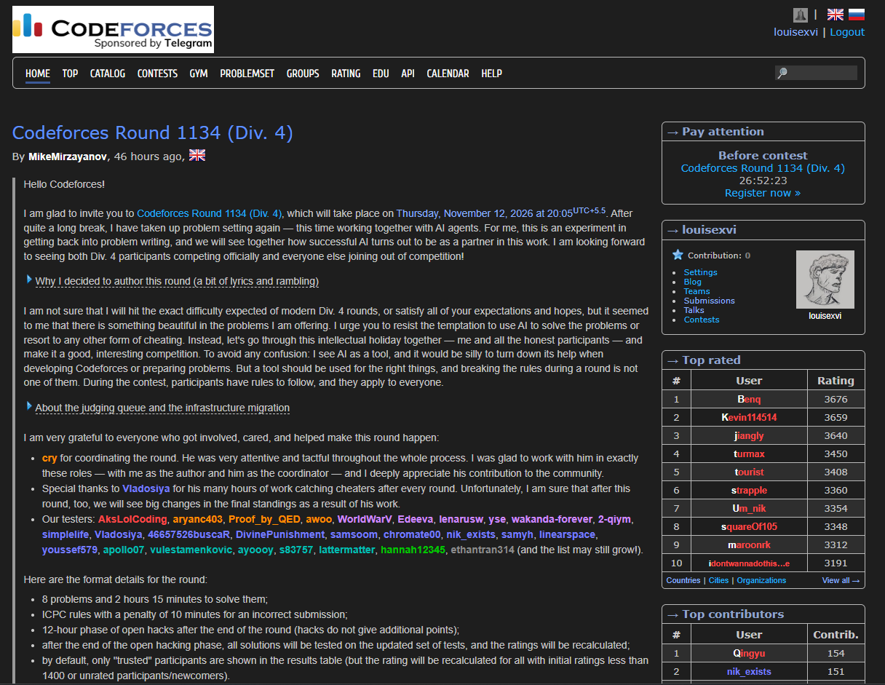

# Codeforce darkmode

<p align="center">
  
  <br>
  <strong>A clean, fully offline dark theme for Codeforces.</strong>
  <br><br>
  <a href="https://github.com/Ravish-Vishwakarma/Codeforces-Darkmode">
    
  </a>
  
  
</p>

## Preview

This is Codeforces with the extension applied:



## About

A clean dark theme for Codeforces, packaged as a fully offline Chrome
(Manifest V3) extension.

Source: [github.com/Ravish-Vishwakarma/Codeforces-Darkmode](https://github.com/Ravish-Vishwakarma/Codeforces-Darkmode)

There is **no update URL, no remote CSS, no remote images, no analytics and no
network access of any kind**. Every file it needs is in this folder:

```
.
├── manifest.json
├── content.js     # theme logic that has to run in JavaScript
├── theme.css      # page styling
├── code.css       # prettyprint + editor colours
├── popup.html     # toolbar popup: version + GitHub link
├── popup.css
├── popup.js
├── imgs/          # lava menu images, bundled locally
├── icons/         # extension icons
└── README.md
```

| File | Purpose |
| --- | --- |
| `theme.css` | Backgrounds, tables, links, inputs, rating colours |
| `code.css` | Syntax colours for `prettyprint` views and the Ace code box |
| `content.js` | Inline-style overrides, editor class swap, 404 detection, test-case backgrounds |
| `popup.html` / `popup.css` / `popup.js` | Toolbar popup showing the version and a GitHub link |
| `imgs/` | Lava menu images used by `content.js` via `chrome.runtime.getURL()` |

## Install (unpacked)

1. Clone this repository (or download it as a ZIP and extract it).
2. Open `chrome://extensions` (or `edge://extensions`).
3. Turn on **Developer mode** (top-right).
4. Click **Load unpacked** and select the repository folder.
5. Open <https://codeforces.com> — it should already be dark.

Because it is loaded unpacked, the browser never updates it on its own. To
update it, replace the files and press the reload icon on the extension card.

Clicking the toolbar icon opens a small popup with the version number and a link
to the project's GitHub page.

## Notes

- Don't run another copy of the theme on the same profile; it would be applied twice.
- Permissions are minimal: the content script matches `codeforces.com` and the
  bundled images are exposed as web-accessible resources to that site. There is
  no `host_permissions`, no background worker, no storage and no network access.
- The extension icon loads at 16, 32, 48 and 128 px from `icons/`.
